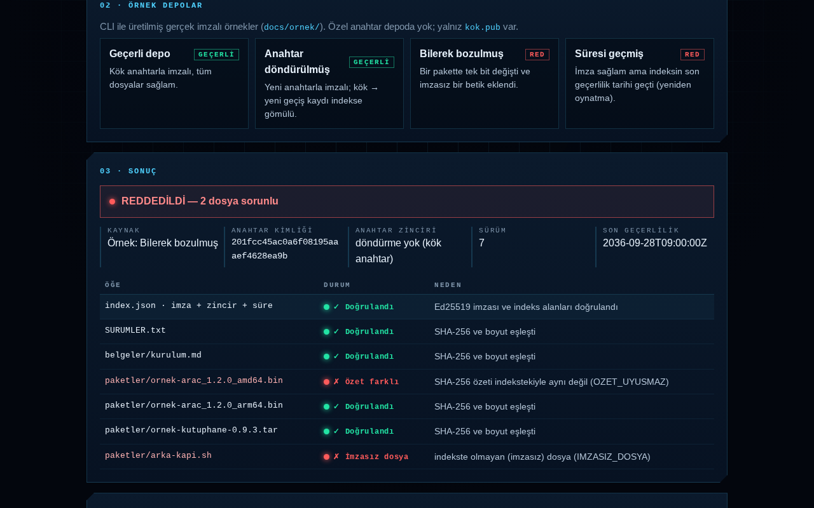

# imzali-depo

[](https://github.com/mrsemihkaba/imzali-depo/actions/workflows/ci.yml)
[](LICENSE)
[](https://mrsemihkaba.github.io/imzali-depo/)

**Ed25519 ile imzalı yazılım/dosya deposu indeksi üreten ve doğrulayan araç** — tedarik zinciri bütünlüğü için.
Bir dizindeki her dosyanın boyutunu ve SHA-256 özetini `index.json`'a yazar, indeksi ayrık bir Ed25519
imzasıyla (`index.json.sig`) imzalar; doğrulayıcı imzayı, süre sonunu, anahtar döndürme zincirini ve her
dosyanın özetini denetler. Aynı doğrulama tarayıcıda da (WebCrypto) çalışır.

**Panel:** https://mrsemihkaba.github.io/imzali-depo/ — klasörü sürükleyip bırakın, dosyalar cihazınızdan çıkmadan doğrulansın.



## Ne yapar

| Komut | İş |
|---|---|
| `imzali-depo anahtar-uret` | Ed25519 anahtar çifti üretir; özel anahtar **parolayla şifreli** PEM (kip `0600`), açık anahtar ayrı PEM. |
| `imzali-depo imzala <dizin>` | `index.json` (dosya adı, boyut, SHA-256, sürüm, oluşturma zamanı, son geçerlilik, anahtar kimliği) + ayrık `index.json.sig`. |
| `imzali-depo dogrula <dizin> --acik-anahtar kok.pub` | İmza + zincir + süre + her dosyanın özeti. Eksik, değişmiş ve **imzasız eklenmiş** dosyaları ayrı ayrı raporlar. Çıkış kodu 0 = geçerli, 1 = reddedildi. |
| `imzali-depo anahtar-dondur` | Yeni açık anahtarı **eski anahtarla imzalayan** geçiş kaydı ekler; sonraki indeksler zinciri taşır, eski kök anahtara güvenen doğrulayıcılar da yeni imzayı kabul eder. |

Yeniden oynatma ve geri alma koruması: her indeksin `son_gecerlilik` alanı vardır (varsayılan 30 gün);
`--en-dusuk-surum` eski sürümü, `--bilinen-zincir` çalınmış eski anahtarla zincirsiz imzalanmış indeksi reddeder.
Biçimin tamamı ve tehdit modeli: **[BICIM.md](BICIM.md)**.

## Kurulum ve kullanım

```bash
python -m venv .venv && . .venv/bin/activate
pip install -e .            # bağımlılık: cryptography

imzali-depo anahtar-uret --ozel imza.key --acik imza.pub      # parola sorulur
imzali-depo imzala ./depo --ozel-anahtar imza.key --gecerlilik-gun 30
imzali-depo dogrula ./depo --acik-anahtar imza.pub
#  [GEÇERLİ] indeks: TAMAM
#    ✓ TAMAM           paketler/arac-1.2.0.tar
#  ...

# anahtar döndürme
imzali-depo anahtar-uret --ozel yeni.key --acik yeni.pub
imzali-depo anahtar-dondur --eski-ozel imza.key --yeni-acik yeni.pub --zincir zincir.json
imzali-depo imzala ./depo --ozel-anahtar yeni.key --zincir zincir.json
imzali-depo dogrula ./depo --acik-anahtar imza.pub --bilinen-zincir zincir.json --json
```

Parola sırasıyla `--parola-dosyasi`, `IMZALI_DEPO_PAROLA` ortam değişkeni ya da etkileşimli istemden alınır;
hiçbir zaman diske yazılmaz. `*.key` dosyaları `.gitignore`'dadır.

## Panel (tarayıcıda doğrulama)

`docs/` derleme adımı olmayan düz HTML + vanilla JS'tir; sunucu yoktur, dış istek yoktur.

* `index.json`, `index.json.sig`, açık anahtar (`.pub`/`.pem`) ve depo dosyalarını (ya da klasörü) bırakın →
  imza `crypto.subtle.verify({name:'Ed25519'})`, dosyalar `crypto.subtle.digest('SHA-256')` ile doğrulanır;
  sonuç tablosu her satır için yeşil/kırmızı ve nedenini gösterir.
* Tarayıcı Ed25519 desteklemiyorsa (gerçek bir RFC 8032 test vektörüyle sınanır) açık bir uyarı gösterilir.
* **Örnek depolar** (`docs/ornek/`): CLI ile üretilmiş gerçek imzalı örnekler — geçerli, anahtarı döndürülmüş,
  bilerek bozulmuş (tek bit + imzasız betik) ve süresi geçmiş. Özel anahtarlar üretim sırasında geçici dizinde
  oluşturulup silinmiştir; depoda yalnız `docs/ornek/anahtarlar/kok.pub` vardır. Yeniden üretmek için
  `python araclar/ornek_uret.py`.

## Testler

```bash
pip install -e ".[test]" && pytest          # 26 test
npm ci && npm test                          # 19 test, headless Chrome
```

* **Python** (`tests/`): geçerli imza; 1 bit bozuk dosya, boyutu değişen / eksik / imzasız eklenen dosya;
  bozulmuş indeks (özet güncellenmiş ama imza tutmuyor); bozuk imza dosyası; yanlış anahtar ve sahte anahtar
  kimliği; süresi geçmiş ve gelecek tarihli indeks; `../` yolu; iki halkalı anahtar döndürme zinciri, sahte ve
  kurcalanmış geçiş kaydı, çalınmış eski anahtarla geri alma; CLI uçtan uca.
* **Kontrol grubu** (`tests/test_kontrol_grubu.py`): imza doğrulaması, özet karşılaştırması, süre denetimi ve
  zincir imzası **tek tek bilerek kapatılır** (yalnız test eklentisiyle; ürün kodunda kapatma anahtarı yoktur) ve
  reddetme testlerinin gerçekten düştüğü gösterilir. Mutasyonsuz koşu ise tamamen geçer.
* **Eşdeğerlik** (`tests/js/`): panel headless Chrome'da `/imzali-depo/` alt yolunda açılır; her örnek
  düğmesine tıklanır ve sonuç `imzali-depo dogrula --json` çıktısıyla **alan alan aynı** olmalıdır. Ayrıca
  geçerli örnekten türetilen 9 bozulma (indekste 1 bayt, dosyada 1 bit, kısaltma, silme+ekleme, kesik imza,
  başka imza, bozuk JSON, yanlış anahtar…) hem Python'a hem tarayıcıya verilir. Dosya seçme ile doğrulama,
  klavye kullanımı, 375 px'te taşma olmaması, Ed25519 desteği olmayan tarayıcı ve tarayıcı tarafı kontrol grubu
  da sınanır.

## Lisans

MIT — bkz. [LICENSE](LICENSE). © 2026 Semih Kaba

---

## English

**imzali-depo** produces and verifies Ed25519-signed indexes for software/file repositories (supply-chain integrity).

* `imzali-depo anahtar-uret` — generate an Ed25519 key pair; the private key is a password-encrypted PKCS#8 PEM, the public key a separate SPKI PEM.
* `imzali-depo imzala <dir>` — write `index.json` (name, size, SHA-256 of every file, version, creation time, expiry, key id) and a detached signature `index.json.sig` over its raw bytes.
* `imzali-depo dogrula <dir> --acik-anahtar root.pub` — verify the key-rotation chain, the signature, expiry, optional minimum version, and every file's digest; missing, modified and unsigned extra files are reported individually.
* `imzali-depo anahtar-dondur` — key rotation: the old key signs a transition record for the new key; indexes embed the chain so verifiers that trust the original root keep working.

**Panel:** https://mrsemihkaba.github.io/imzali-depo/ — a browser-only verifier: drop the index, signature, public key and files; verification uses WebCrypto Ed25519 and SHA-256, nothing leaves the device. Bundled sample repositories (valid, rotated key, deliberately tampered, expired) were produced with the CLI; only the public key is committed. A headless-Chrome test shows the browser verifier returns field-for-field the same result as the Python CLI on every sample and on nine derived tamperings.

The format and threat model are specified in [BICIM.md](BICIM.md) (Turkish). Tests: `pytest` (26, including a mutation-based control group that disables each check and shows the rejection tests fail) and `npm test` (19, headless Chrome). License: MIT.
